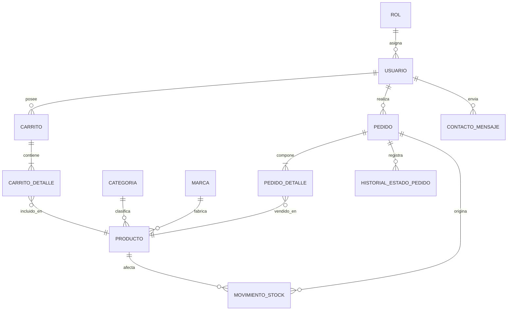
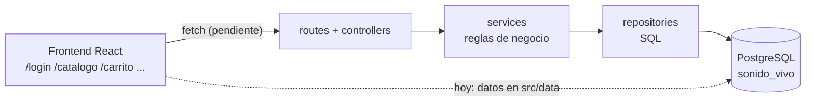
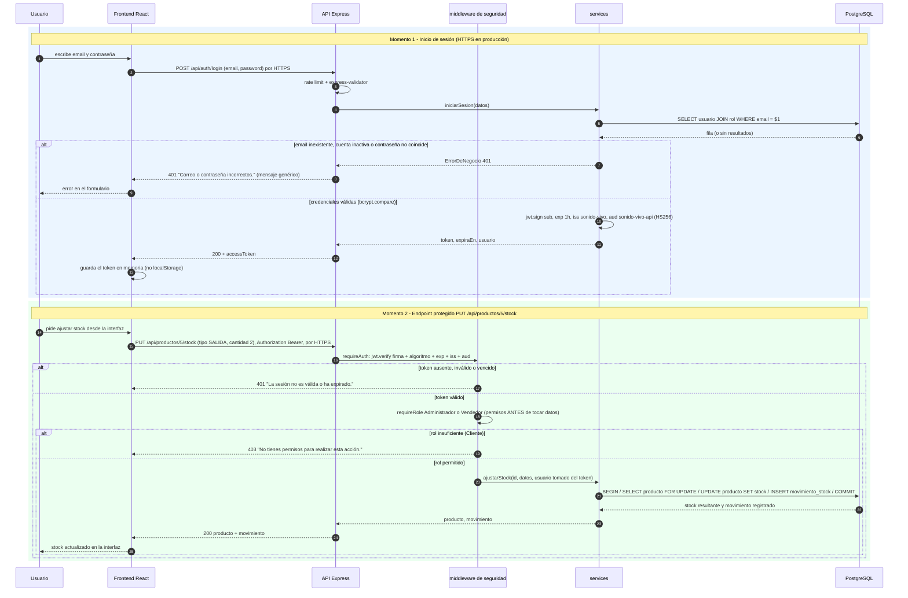

# API REST Sonido Vivo — Backend

Repositorio del **backend del proyecto semestral Sonido Vivo** (tienda de
instrumentos musicales y equipos de sonido, Viña del Mar), curso
**DSY1104 — Desarrollo FullStack II**, Duoc UC.

Esta fase corresponde a la **planificación y construcción inicial** del backend
(guía de planificación, dos semanas): estructura por capas, base de datos,
primeros endpoints con autenticación JWT y documentación viva. **No es el
sistema completo**: los pendientes están listados en la sección 9.

- Integrante: **Vicente Markov** (equipo de un integrante).
- Repositorio del frontend: <https://github.com/VicMarkov/ProyectoSN>
- Swagger UI (al correr el servidor): <http://localhost:3000/api/docs>

---

## 1. Identificación y alcance

**Caso de negocio:** Sonido Vivo necesita migrar su tienda desde la simulación
del Parcial 1 hacia una solución con API REST y base de datos, manteniendo el
catálogo, la autenticación de usuarios y la gestión de stock como primer
bloque funcional.

**Qué cubre el backend en esta fase:**

| Área | Alcance |
|---|---|
| Autenticación | Registro de clientes, inicio de sesión con JWT, consulta de la sesión vigente (`/api/auth/me`) |
| Catálogo | Listado paginado con filtro por categoría y búsqueda, detalle de producto, categorías con conteo |
| Stock | Ajuste de stock (entrada / salida / ajuste) con roles, transacción y auditoría en `movimiento_stock` |
| Seguridad | Hash bcrypt de contraseñas, tokens con vigencia, roles, rate limit, CORS, validación en el servidor |
| Documentación | OpenAPI 3.0 + Swagger UI en línea, evidencias de pruebas reales |

**Qué no cubre todavía (diseñado o propuesto, pendiente de construir):**
carrito de compras, pedidos y su historial de estados, mensajes de contacto,
administración de usuarios, integración con el frontend React y despliegue en
la máquina virtual (EC2). Todo ello está especificado en `docs/openapi.yaml`
con `x-estado: pendiente`.

---

## 2. Referencia al frontend

- Frontend (React 19 + Vite): <https://github.com/VicMarkov/ProyectoSN>
  (carpeta `frontend-react/`).
- El README del frontend enlaza este repositorio de backend.
- El frontend hoy funciona **sin backend** (datos en
  `src/data/productos.js` y sesión simulada con `localStorage`); la
  integración es un paso futuro y está planificada en la sección 9.

---

## 3. Decisiones técnicas

### 3.1 Solución elegida (paso 1 de la guía)

| Decisión | Elección | Justificación |
|---|---|---|
| Tecnología backend | **Node.js 24 + Express 5** | La guía permite elegir entre Spring Boot y Node.js. Se eligió Node por la base común de lenguaje con el frontend (JavaScript/ESM), arranque inmediato en desarrollo y despliegue simple. El ERS se actualizó a v1.2 para reflejar esta decisión. |
| Ejecución | **EC2** (máquina virtual del curso) | Frente a Lambda, EC2 ofrece control total del proceso largo (servidor Express + conexión persistiente a PostgreSQL) y coincide con la práctica de la Guía 18. **Estado actual: ejecución local** en Windows; el despliegue en la VM queda como paso posterior de la Guía 18. |
| Motor de base de datos | **PostgreSQL 16 local** (sin instalar servicios: binarios incluidos con `embedded-postgres`) | Mismo motor que se usará en RDS PostgreSQL en la actividad final de la Guía 18, evitando migraciones; expresa fielmente el diagrama (enums con `CHECK`, `BOOLEAN`, `DECIMAL`, `TIMESTAMP`). No se usó SQLite porque su modo de archivo no representa el modelo de servidor que exige la guía. |
| Autenticación | **JWT (HS256) con vigencia de 1 hora** | Flujo que exige la guía; estado sin servidor, sin sesión en la BD. |
| API docs | **OpenAPI 3.0 + Swagger UI** servidos por la misma API | Documentación viva y comprobable desde el navegador. |

> El `.env` (con `JWT_SECRET` y credenciales locales de la BD) está en
> `.gitignore`: **no se versionan secretos**. `.env.example` documenta la
> configuración sin valores reales.

> **Cómo se mantendrá activo el proceso en EC2 (diseñado, pendiente de
> despliegue):** Node.js correrá bajo un gestor de procesos (**pm2** o un
> servicio **systemd**) que lo reinicie automáticamente ante caídas, y un
> reverse proxy (**nginx**) expondrá **HTTPS** (certificado Let's Encrypt)
> delante de Express; la base de datos pasará a **RDS PostgreSQL** (Guía 18).
> Hoy, en local, el proceso se mantiene con las terminales de
> `npm run db:start` y `npm start`.

### 3.2 Componentes elegidos

| Paquete | Versión | Para qué sirve |
|---|---|---|
| `express` | 5.3 | Servidor HTTP y enrutamiento (maneja errores de promesas asincrónicas) |
| `cors` | 2.8 | Restringe los orígenes permitidos al frontend |
| `pg` | 8.23 | Cliente y pool de conexiones a PostgreSQL |
| `bcrypt` | 6.0 | Hash de contraseñas (costo 12) |
| `jsonwebtoken` | 9.0 | Firmar y verificar tokens JWT |
| `express-validator` | 7.3 | Validación de entrada (body, query, params) |
| `express-rate-limit` | 8.7 | Límite de intentos de login |
| `swagger-ui-express` + `js-yaml` | 5.0 / 5.5 | Sirven Swagger UI desde `docs/openapi.yaml` |
| `dotenv` | 18 | Variables de entorno desde `.env` |
| `embedded-postgres` (dev) | 16.15 | Binarios de PostgreSQL 16 para desarrollo local |
| `fetch` nativo de Node (sin framework de tests) | — | Pruebas de API: `scripts/smoke.mjs` llama a la API real con `fetch` (incluido en Node ≥ 20) y verifica estados HTTP y cuerpos JSON; se evitó Jest/supertest porque la suite no prueba unidades internas sino el comportamiento HTTP que exige la guía |

### 3.3 Estructura del proyecto

```
backend/
├── package.json            Scripts: start, dev, db:start, db:reset, pruebas:api
├── .env.example            Configuración documentada (sin secretos)
├── db/
│   ├── schema.sql          Esquema completo (12 tablas, PK/FK/UK/CHECK/índices)
│   └── seed.sql            Semilla: roles, usuarios demo, 10 categorías,
│                           26 marcas y los 51 productos del catálogo frontend
├── docs/
│   ├── openapi.yaml        Contrato OpenAPI 3.0 (implementado y pendiente)
│   ├── diagrama_entidad_relacion.svg
│   └── evidencias/         Registro real de las corridas de pruebas
├── scripts/
│   ├── db.mjs              npm run db:start → PostgreSQL local
│   ├── reset.mjs           npm run db:reset  → esquema + semilla
│   └── smoke.mjs           npm run pruebas:api → 37 casos de prueba
└── src/
    ├── server.js           Escucha en PORT (3000)
    ├── app.js              CORS, rate limit, Swagger UI, rutas, errores
    ├── config/db.js        Pool de PostgreSQL
    ├── routes/             Definición de rutas (contrato HTTP)
    ├── controllers/        Recibe request / arma response
    ├── services/           Reglas de negocio (auth, ajuste de stock)
    ├── repositories/       Consultas SQL (usuarios, productos)
    ├── middleware/         requireAuth, requireRole, validación, errores
    └── validators/         Reglas de express-validator
```

---

## 4. Diseño de datos

### 4.1 Diagrama entidad-relación

- Diagrama completo (Mermaid, exportado a SVG):
  [`docs/diagrama_entidad_relacion.svg`](docs/diagrama_entidad_relacion.svg)
- **Pendiente:** subirlo a Google Drive con acceso de lectura para el docente y
  reemplazar este párrafo por el enlace directo (checklist de la guía).

El modelo tiene **12 entidades**:

| Entidad | Rol en el modelo |
|---|---|
| `ROL` | Catálogo de roles: Administrador, Vendedor, Cliente |
| `USUARIO` | Cuentas con `password_hash`, `activo` y FK a `ROL` |
| `CARRITO`, `CARRITO_DETALLE` | Carrito de un usuario con sus líneas (cantidad > 0) |
| `PRODUCTO` | Catálogo: SKU único, precio, stock, stock mínimo, FK a categoría y marca |
| `CATEGORIA`, `MARCA` | Clasificación del catálogo (nombre único) |
| `PEDIDO` | Cabecera: número único, estado, tipo de entrega, totales |
| `PEDIDO_DETALLE` | Líneas con cantidad, precio unitario y *snapshot* de `nombre_producto` |
| `HISTORIAL_ESTADO_PEDIDO` | Trazabilidad de cambios de estado (antes/después/usuario) |
| `MOVIMIENTO_STOCK` | Auditoría de stock: tipo ENTRADA/SALIDA/AJUSTE, stock resultante, usuario |
| `CONTACTO_MENSAJE` | Mensajes del formulario de contacto (tipo STOCK/REPARACION/OTRA) |

### 4.2 Relaciones y restricciones relevantes

Relaciones principales (cardinalidad desde el usuario hacia el recurso):



Restricciones implementadas en `db/schema.sql`:

- **Únicas (`UNIQUE`)**: `usuario.email`, `producto.sku`, `categoria.nombre`,
  `marca.nombre`, `pedido.numero_pedido`, y `(id_carrito, id_producto)` para
  no repetir un producto en el mismo carrito.
- **Enums con `CHECK`**: estados de pedido (`EN_PREPARACION/DESPACHADO/ENTREGADO`),
  tipo de entrega (`DOMICILIO/RETIRO_TIENDA`), tipo de movimiento
  (`ENTRADA/SALIDA/AJUSTE`), tipo de consulta y estado de contacto.
- **Dominio**: `precio >= 0`, `stock >= 0`, `cantidad > 0`,
  y `CONSTRAINT chk_direccion`: si la entrega es `DOMICILIO`,
  `direccion_despacho` es obligatoria (NULL solo si es retiro en tienda).
- **Integridad referencial**: todas las FK declaradas; `ON DELETE CASCADE`
  en dependencias fuertes (detalle de carrito/pedido, historial) y
  `NO ACTION` (por defecto) en el resto.
- **Borrado lógico**: `usuario.activo`, `producto.activo` y
  `categoria.activo` (no se eliminan filas en producción).
- **Auditoría**: todo cambio de stock genera fila en `movimiento_stock` con
  el usuario responsable y el stock resultante.
- Índices en las FK de mayor uso (`producto.id_categoria`, `producto.id_marca`,
  `pedido.id_usuario`, `movimiento_stock.id_producto`).

### 4.3 Datos de prueba

Poblar desde cero: `npm run db:reset` (reesquema + semilla).

| Dato | Contenido |
|---|---|
| Roles | 1 Administrador, 2 Vendedor, 3 Cliente (los tres documentados en el ERS) |
| Usuarios | `admin@sonidovivo.cl`, `vendedor@sonidovivo.cl`, `demo@sonidovivo.cl` — todos con contraseña `demo123` guardada como **hash bcrypt costo 12** (nunca en claro; son cuentas de prueba, no credenciales reales) |
| Catálogo | 10 categorías, 26 marcas y **51 productos**: los mismos del frontend (`frontend-react/src/data/productos.js`, muestra de 340 referencias) |
| Movimientos | Vacíos; se llenan al usar el endpoint de stock |

> Los datos simulados del frontend se convirtieron en la semilla inicial de
> prueba del backend, tal como pide la guía: mismo SKU, nombre, modelo,
> descripción, precio y stock.

**Qué persiste tras reiniciar:** reiniciar el servidor (`Ctrl+C` y
`npm start`) **no toca la base de datos**: los usuarios creados por API, los
ajustes de stock y sus movimientos se conservan, porque PostgreSQL persiste
todo en `.pgdata/`. En cambio, `npm run db:reset` es una herramienta **solo
de desarrollo**: borra el esquema y vuelve a aplicar `db/schema.sql` +
`db/seed.sql`, con lo que repuebla los 51 productos con su stock inicial
(GA001 vuelve a 8) y restaura las tres cuentas demo; los usuarios creados
por API durante la prueba desaparecen.

---

## 5. Organización y responsabilidades

### 5.1 Qué hace cada capa

| Capa | Responsabilidad | Archivos |
|---|---|---|
| `routes/` | Traducir el contrato HTTP a controladores; encadenar validación y seguridad | `auth.routes.js`, `productos.routes.js`, `index.js` |
| `controllers/` | Recibir la request, llamar al servicio y armar la response | `auth.controller.js`, `productos.controller.js` |
| `services/` | Reglas de negocio: hash/verificación, emisión JWT, cálculo de stock con transacción | `auth.service.js`, `productos.service.js`, `errores.js` |
| `repositories/` | Únicos responsables del SQL | `usuarios.repo.js`, `productos.repo.js` |
| `middleware/` | `requireAuth` (verifica JWT), `requireRole`, validación, manejo de errores 404/500 | `auth.middleware.js`, `validacion.middleware.js`, `error.middleware.js` |
| `validators/` | Reglas declarativas de express-validator | `auth.validators.js`, `productos.validators.js` |
| `config/` | Pool de conexión según `.env` | `db.js` |
| `scripts/` | Operación de BD y pruebas | `db.mjs`, `reset.mjs`, `smoke.mjs` |

Esquema general de la integración (hacia el futuro):



### 5.2 Asignación de validaciones y campos (paso 4)

**Validación por capa** — para la operación elegida (inicio de sesión) y la
operación protegida principal (ajuste de stock):

| Validación | Capa responsable | Resultado |
|---|---|---|
| Formato de email, largo de contraseña, `tipo` y `cantidad` | Ruta + `validators/` (express-validator), **antes** de llegar al servicio | `400` con detalle campo a campo |
| Límite de intentos de login | Middleware global de rate limit (`app.js`) | `429` |
| La cuenta existe, está activa y la contraseña coincide | `services/` (`bcrypt.compare`) | `401` con mensaje genérico |
| Rol permitido (Vendedor / Administrador) | `middleware/` (`requireRole`), **antes de consultar o modificar datos** | `403` |
| Stock insuficiente y cantidad inválida | `services/` dentro de la transacción | `409` / `400` |
| Email duplicado en el registro | `services/` vía `repositories/` | `409` |
| Unicidad, enums, dominios y FK (última línea de defensa) | **Base de datos** (`UNIQUE`, `CHECK`, `FOREIGN KEY` en `db/schema.sql`) | error 500 controlado |

**Campos calculados por el servidor vs. recibidos del cliente** — el frontend
no decidirá por sí solo el precio final, el rol del usuario ni la propiedad
de un registro:

| Dato | Quién lo define |
|---|---|
| `id_usuario`, `fecha_creacion`, `activo` y el rol inicial `Cliente` | **Servidor** (en el registro) |
| `password_hash` (bcrypt costo 12) | **Servidor**; nunca se recibe ni devuelve en claro |
| `token`, `exp`, `iss`, `aud` | **Servidor** (en el login) |
| `stock_resultante`, `id_movimiento`, fecha del movimiento | **Servidor** (ajuste de stock, dentro de la transacción) |
| Email, contraseña, nombre y teléfono | Cliente (los envía al registrarse) |
| `tipo` y `cantidad` del ajuste de stock | Cliente (los envía); el **resultado** lo recalcula el servidor |
| Precio final, totales del pedido y pertenencia de un registro | **Solo el servidor** (los pedidos aún no existen; nunca viajarán desde React) |

### 5.3 Responsabilidades por integrante

| Integrante | Responsabilidades |
|---|---|
| Vicente Markov | Diseño de datos (ER → SQL), diseño de contratos y seguridad, implementación completa de las capas del backend, pruebas de la API, documentación (README, OpenAPI, ERS) y coordinación con el frontend. |

---

## 6. API y documentación viva

### 6.1 Cómo consultarla y probarla

1. Levantar la base (`npm run db:start`, ventana 1) y el servidor
   (`npm start`, ventana 2).
2. Abrir **<http://localhost:3000/api/docs>** en el navegador.
3. Para rutas protegidas: botón **Authorize** → valor `Bearer <token>` (el
   token se obtiene ejecutando `POST /api/auth/login` con
   `{"email":"demo@sonidovivo.cl","password":"demo123"}`).
4. La fuente del contrato es [`docs/openapi.yaml`](docs/openapi.yaml);
   Swagger UI lo renderiza en vivo.

### 6.2 Recursos y operaciones

| Método | Ruta | Rol requerido | Estado |
|---|---|---|---|
| POST | `/api/auth/register` | Público | ✅ Implementado |
| POST | `/api/auth/login` | Público | ✅ Implementado |
| GET | `/api/auth/me` | Autenticado | ✅ Implementado |
| GET | `/api/productos` | Público | ✅ Implementado (filtro `categoria`, `q`, paginación) |
| GET | `/api/productos/categorias` | Público | ✅ Implementado |
| GET | `/api/productos/{id}` | Público | ✅ Implementado |
| PUT | `/api/productos/{id}/stock` | Vendedor / Administrador | ✅ Implementado (transacción + auditoría) |
| GET/POST | `/api/carrito` | Cliente | 🕓 Pendiente |
| PUT | `/api/carrito/{id}` | Cliente (solo el suyo) | 🕓 Pendiente |
| GET/POST | `/api/pedidos` | Cliente (suyos) / Admin | 🕓 Pendiente |
| PUT | `/api/pedidos/{id}/estado` | Vendedor / Administrador | 🕓 Pendiente |
| POST | `/api/contacto` | Público | 🕓 Pendiente |
| GET/PUT | `/api/usuarios/{id}` | Administrador | 🕓 Pendiente |

Códigos de estado usados: `200/201` éxito, `400` validación, `401` sin sesión
válida, `403` sin permisos, `404` recurso inexistente, `409` conflicto de
negocio o duplicidad, `429` límite de intentos, `500` error interno (mensaje
genérico, sin filtrar detalles).

**Operaciones que no se exponen a propósito** (no corresponden al caso de
negocio actual):

- `DELETE /api/productos/{id}`: el catálogo usa **borrado lógico**
  (`producto.activo = false`) para conservar el histórico de pedidos y
  movimientos; en producción no se eliminan filas.
- `DELETE /api/usuarios/{id}`: mismo criterio — los usuarios se
  **desactivan** (`usuario.activo = false`) y la auditoría se preserva.
- Alta o edición de productos y precios: no hay requisito (RF) que lo pida en
  el ERS actual; los precios nacen del catálogo oficial (340 referencias) y
  el servidor será el único que calcule precio total y totales cuando existan
  los pedidos.

### 6.3 Relación con las pantallas del frontend

| Pantalla frontend | Operaciones de la API | Relación |
|---|---|---|
| `/login` | `POST /api/auth/register`, `POST /api/auth/login`, `GET /api/auth/me` | **Operación completa elegida** (recorrido extremo a extremo): desde el formulario de login hasta obtener y consultar el token. Ver §7.3. |
| `/` (inicio) | `GET /api/productos` (página 1) | Productos destacados desde la API (hoy desde `src/data`) |
| `/catalogo` | `GET /api/productos`, `GET /api/productos/categorias` | Lista, filtro por categoría y búsqueda |
| Detalle de producto (futuro con `useParams`) | `GET /api/productos/{id}` | Página de detalle aún no creada en React |
| `/carrito`, `/pedido` | `GET/POST /api/carrito`, `GET/POST /api/pedidos` | Pendientes (hoy simulados con contexto y `localStorage`) |
| Historial de compras (futuro) | `GET /api/pedidos` filtrado por el token | Pendiente: el cliente verá **solo los suyos** (anti-IDOR) |
| `/contacto` | `POST /api/contacto` | Pendiente (hoy solo validación en cliente) |
| Panel de administración (futuro) | `PUT /api/productos/{id}/stock`, `GET/PUT /api/usuarios/{id}` | Pendiente |

**Estados que la interfaz deberá mostrar** (paso 2 — cómo presentará cada
respuesta de la API):

| Estado | Cuándo ocurre | HTTP | Qué mostrará React |
|---|---|---|---|
| Carga | mientras `fetch` está en curso | — | spinner o botón deshabilitado |
| Éxito | respuesta correcta | `200` / `201` | datos renderizados o mensaje de éxito |
| Datos vacíos | lista sin resultados | `200` con `[]` | "no hay productos que coincidan" |
| Error de validación | formulario mal enviado | `400` + `errores[]` | mensajes campo a campo (nunca `alert()`) |
| Sesión vencida | token ausente, inválido o expirado | `401` | aviso y retorno al `/login` |
| Falta de permisos | rol insuficiente | `403` | "no tienes permisos para esta acción" |
| Error del servidor | fallo inesperado | `500` | mensaje genérico con opción de reintentar |

**Funciones de `src/services/` que pasarán a consultar la API** (hoy devuelven
datos simulados):

| Archivo en el frontend | Funciones | Rutas de la API |
|---|---|---|
| `auth.service.js` | `registrar`, `iniciarSesion`, `obtenerSesion` | `POST /api/auth/register`, `POST /api/auth/login`, `GET /api/auth/me` |
| `productos.service.js` | `listarProductos`, `obtenerProducto`, `listarCategorias` | `GET /api/productos`, `GET /api/productos/{id}`, `GET /api/productos/categorias` |
| `stock.service.js` | `ajustarStock` | `PUT /api/productos/{id}/stock` |
| `carrito.service.js`, `pedidos.service.js`, `contacto.service.js` | carrito, pedidos e historial, contacto | recursos con `x-estado: pendiente` |

**Cómo quedará la integración (pendiente):** crear `src/services/` en el
frontend con llamadas `fetch` a estas rutas, los estados de la tabla anterior
en las pantallas, y reemplazo de los datos de `src/data/productos.js` y de la
sesión de `localStorage` por la API. Las 138 pruebas del frontend deberán
adaptarse (con mocks de `services/`) sin perder cobertura.

---

## 7. Seguridad

### 7.1 Protección de contraseñas (investigación y justificación)

Las contraseñas **nunca se guardan ni transmiten en claro**: se almacena
únicamente su hash con sal aleatoria por usuario (`usuario.password_hash`).

**Elección: bcrypt con costo 12** (`src/services/auth.service.js`):

- OWASP recomienda Argon2id como primera opción y, cuando no está disponible,
  **bcrypt con factor de trabajo ≥ 10** y límite de 72 bytes; usa 12 como
  línea base recomendada. Este proyecto usa **costo 12** (cada incremento
  duplica el trabajo del atacante y del servidor) y el validador de registro
  limita la contraseña a **72 caracteres** para respetar el límite de bcrypt.
- bcrypt incorpora **sal única por contraseña** (impide tablas rainbow) y es
  **lento a propósito** (diseñado para contraseña, a diferencia de SHA-256/MD5
  que son rápidos y no sirven para este uso).
- Es la opción disponible de forma nativa en el ecosistema Node (`bcrypt`);
  si el proyecto crece, la migración a Argon2id no toca el modelo (sigue
  siendo un hash en la misma columna).

Fuentes:

1. OWASP — *Password Storage Cheat Sheet*:
   <https://cheatsheetseries.owasp.org/cheatsheets/Password_Storage_Cheat_Sheet.html>
2. OWASP — *REST Security Cheat Sheet*:
   <https://cheatsheetseries.owasp.org/cheatsheets/REST_Security_Cheat_Sheet.html>
3. Provos & Mazières — *A Future-Adaptable Password Scheme* (bcrypt, USENIX 1999):
   <https://www.usenix.org/legacy/events/usenix99/provos/provos.pdf>
4. jsonwebtoken (implementación usada):
   <https://www.npmjs.com/package/jsonwebtoken>

No hay credenciales reales en el repositorio: las cuentas de prueba son datos
de semilla y los secretos viven solo en `.env` (ignorado por git).

### 7.2 Flujo JWT (decisiones del paso 6.3)

- **Quién emite y quién verifica:** el token lo firma **solo el backend**
  (`src/services/auth.service.js`) al validar el login, y lo verifica **solo
  el backend** (`src/middleware/auth.middleware.js`) en cada ruta protegida.
  React solo lo transporta en memoria: decodificar un token en el navegador
  **no es una verificación**.
- **Algoritmo y claves:** único algoritmo permitido **HS256**
  (`jwt.verify(..., { algorithms: ['HS256'] })`), de modo que un token
  firmado con `none` u otro algoritmo se rechaza. La clave `JWT_SECRET` vive
  **solo en `.env`** (ignorado por git): fuera de React y fuera del
  repositorio.
- **Claims** (se firman con `issuer`/`audience` y **se exigen** al verificar):

| Claim | Valor | Obligatoriedad / justificación |
|---|---|---|
| `sub` | id del usuario | Obligatorio: identidad del dueño del token |
| `exp` | emisión + 1 hora | Obligatorio: vigencia máxima |
| `iss` | `sonido-vivo` | Obligatorio: quién lo emitió (evita aceptar tokens de otro emisor) |
| `aud` | `sonido-vivo-api` | Obligatorio: para qué API es válido (evita reutilizarlo en otro servicio) |
| `email`, `nombre`, `rol` | datos del usuario | **Datos adicionales justificados**: identifican y autorizan (`requireRole`) sin consultar la BD en cada petición; no incluyen contraseña, RUT ni otros datos sensibles |

- **Verificación en cada request:** `requireAuth` comprueba **firma +
  algoritmo permitido + expiración + emisor + destinatario**; la suite
  incluye los casos `iss` incorrecto, `aud` ausente y algoritmo `none`
  (todos `401`). Decodificar sin verificar no basta.
- **Duración de acceso (1 hora):** equilibrio entre una sesión práctica en
  tienda y la ventana máxima de exposición si el token se roba. Sin refresh
  token (decisión del paso 6.1 para la primera versión): al vencer se vuelve
  a iniciar sesión.
- **Almacenamiento en el frontend (decisión):** token **en memoria**
  (contexto React), no en `localStorage`, para reducir el alcance de un
  robo por XSS. Consecuencia documentada: la sesión se pierde al recargar;
  al implementar la integración, al arrancar la app se consultará
  `GET /api/auth/me` y si responde 401 se volverá a mostrar el login.
- **Cierre de sesión, expiración y cuenta deshabilitada:** el cliente
  descarta el token (JWT es stateless; no hay revocación server-side).
  **Borrar el token del navegador no invalida una copia ya emitida**: el
  token sigue siendo válido hasta su `exp` (máximo 1 hora), incluso si la
  cuenta se deshabilita (`activo = false`) — limitación asumida en esta
  fase. `GET /api/auth/me` sí consulta la BD y responde `401` si la cuenta
  está inactiva. **Cómo se revocará después:** con lista de revocación en
  BD/Redis o refresh tokens con rotación, en la fase de despliegue; hasta
  entonces, la vigencia corta acota el impacto. (No se implementa renovación
  ni endpoint de revocación en esta fase, conforme al paso 6.1.)
- **Vigencia probada:** los casos token expirado, `iss` incorrecto, sin `aud`
  y algoritmo `none` → todos `401` (§8.5).

### 7.3 Diagrama de secuencia (login + endpoint protegido) y casos de rechazo (paso 6.2)

La guía pide representar **dos momentos**: el inicio de sesión y una
solicitud posterior a un **endpoint protegido**, mostrando dónde se valida el
token y dónde se comprueban los permisos **antes de consultar o modificar
datos**. Ambos flujos viajan por **HTTPS en producción** (en desarrollo local
el servidor corre en HTTP; el despliegue con TLS está pendiente, §7.5).



Casos de rechazo considerados (todos probados, §8.5):

| Situación | Respuesta |
|---|---|
| Sin encabezado `Authorization` | `401` "Se requiere iniciar sesión…" |
| Token alterado (firma inválida) | `401` "La sesión no es válida o ha expirado…" |
| Token expirado (pasada la hora) | `401` idéntico |
| Token con `iss` incorrecto o sin claim `aud` | `401` (verificación estricta, §7.2) |
| Token con algoritmo `none` u otro distinto de HS256 | `401` (algoritmo no permitido) |
| Rol insuficiente (Cliente intentando ajustar stock) | `403` "No tienes permisos…" |
| Registro con email duplicado | `409` con mensaje explícito |
| Datos inválidos (email o contraseña con formato erróneo) | `400` con detalle campo a campo |
| Login fallido | `401` genérico, igual exista o no el email |

### 7.4 Permisos por operación y regla anti-IDOR

| Operación | Cliente | Vendedor | Administrador |
|---|---|---|---|
| Listar catálogo / ver detalle / categorías | ✅ | ✅ | ✅ |
| Registrarse / iniciar sesión | ✅ (público) | ✅ (público) | ✅ (público) |
| Consultar la propia sesión (`/me`) | ✅ solo la suya (sale del token) | ✅ | ✅ |
| Ajustar stock de un producto | ❌ `403` | ✅ | ✅ |
| Ver/crear pedidos (pendiente) | ✅ solo los suyos | ✅ los de su atención | ✅ todos |
| Cambiar estado de pedido (pendiente) | ❌ | ✅ | ✅ |
| Activar usuarios / asignar roles (pendiente) | ❌ | ❌ | ✅ |

- **Anti-IDOR:** el backend nunca recibe el `id_usuario` desde la URL para
  consultar datos personales: `/api/auth/me` deriva el usuario del token, y
  los endpoints futuros de pedidos/carrito filtrarán por `req.usuario.id`
  (el cliente podrá ver **solo lo suyo** aunque cambie identificadores en la
  URL). Las rutas de rol se comprueban en el servidor con `requireRole`;
  ocultar botones en React no alcanza.
- **Asignación de roles:** el registro público siempre crea usuarios con rol
  `Cliente` (lo decide el servidor, no el cliente). Cambiar roles quedará
  reservado a `Administrador` (endpoint pendiente `PUT /api/usuarios/{id}`).

### 7.5 Controles previstos

| Control | Estado |
|---|---|
| Límite de intentos de login (50 / 15 min por defecto, configurable con `RATE_LIMIT_MAX`) | ✅ Implementado |
| CORS con orígenes explícitos (`CORS_ORIGINS`, ej. `http://localhost:5173`) — no sustituye la autorización | ✅ Implementado |
| Validación de entrada en **todas** las rutas (body, query, params) | ✅ Implementado |
| Sin contraseñas ni tokens en respuestas ni en logs (`/me` y login no devuelven el hash) | ✅ Implementado |
| Cabecera `X-Powered-By` desactivada; cuerpo JSON limitado a 100 KB | ✅ Implementado |
| HTTPS para credenciales y tokens | 🕓 Pendiente de aplicar en el despliegue (hoy es HTTP local; en EC2 se usará TLS) |
| Revocación de tokens / refresh token | 🕓 No implementado (ver §7.2) |
| Rate limit de la API general y bloqueo de cuentas | 🕓 Pendiente (solo el de login existe) |

---

## 8. Cómo ejecutar y comprobar el avance

### 8.1 Requisitos

- Node.js **20 o superior** (probado con Node 24.11.1 y npm 11.6.2).
- Conexión a internet la primera vez (`npm install` descarga también los
  binarios de PostgreSQL).
- **No** requiere instalar PostgreSQL ni Docker: los binarios vienen en
  `node_modules/embedded-postgres`.

### 8.2 Pasos reproducibles (local)

```bash
# 1) dependencias
npm install

# 2) ventana 1: base de datos local (queda corriendo; Ctrl+C la detiene)
npm run db:start

# 3) ventana 2: esquema + semilla de prueba
npm run db:reset

# 4) ventana 2: servidor
npm start
# → http://localhost:3000/api/docs   (Swagger UI)
# → http://localhost:3000/api/productos (listado JSON)
```

Modo desarrollo con recarga automática: `npm run dev`.

### 8.3 Configuración (`.env`)

Copia `.env.example` a `.env`. Valores por defecto:

| Variable | Valor de ejemplo | Descripción |
|---|---|---|
| `PORT` | `3000` | Puerto del servidor |
| `PGHOST/PGPORT/PGDATABASE` | `localhost/5432/sonido_vivo` | Base de datos |
| `PGUSER/PGPASSWORD` | `sonido/sonido123` | Usuario local de desarrollo |
| `JWT_SECRET` | *(uno aleatorio por entorno)* | Firma de los tokens; nunca se versiona |
| `JWT_EXPIRES_IN` | `1h` | Vigencia del token |
| `CORS_ORIGINS` | `http://localhost:5173` | Orígenes permitidos |
| `RATE_LIMIT_MAX` | `50` | Intentos de login cada 15 minutos |

### 8.4 Cuentas de prueba (datos de semilla, no son credenciales reales)

| Email | Contraseña | Rol |
|---|---|---|
| `demo@sonidovivo.cl` | `demo123` | Cliente |
| `vendedor@sonidovivo.cl` | `demo123` | Vendedor |
| `admin@sonidovivo.cl` | `demo123` | Administrador |

### 8.5 Pruebas realizadas y resultados reales

Suite: `npm run pruebas:api` (reinicia la BD con la semilla, ejecuta **37
casos** contra el servidor en marcha y guarda la evidencia). También puede
comprobarse manualmente desde Swagger UI (§6.1).

**Última corrida: 12-11-2026 22:08 — 37 casos, 37 OK, 0 fallas**
(registro completo en [`docs/evidencias/casos-prueba-api.txt`](docs/evidencias/casos-prueba-api.txt)).

| Grupo | Casos | Qué se comprobó | Resultado real |
|---|---|---|---|
| Documentación | 1 | Swagger UI responde en `/api/docs/` | 200 ✅ |
| Catálogo | 7 | Listado (51 productos), filtro categoría (5), búsqueda, categorías (10), 404 y 400 | Todo OK ✅ |
| Registro | 5 | 201 con rol Cliente asignado por servidor, duplicado 409, contraseña corta 400, y la cuenta creada puede iniciar sesión | Todo OK ✅ |
| Login | 6 | Válido 200 + token con vencimiento; contraseña mala 401; email inexistente 401 con **mensaje idéntico**; formato inválido 400 | Todo OK ✅ |
| Sesión | 8 | `/me` 200 con token válido; sin token 401; token alterado 401; token expirado 401; `iss` incorrecto 401; token sin `aud` 401; algoritmo `none` rechazado 401 | Todo OK ✅ |
| Stock y roles | 7 | Sin token 401; Cliente 403; Vendedor ajusta GA001 (8 → 6) 200; salida mayor que el stock **409** (conflicto de negocio); cantidad 0 → 400; movimiento registrado en `movimiento_stock` | Todo OK ✅ |
| General / CORS | 3 | Ruta inexistente 404 en JSON; preflight desde `localhost:5173` aceptado | Todo OK ✅ |

Ejemplo real de conflicto de negocio (HTTP 409):

```json
{ "error": "Stock insuficiente: quedan 6 unidades disponibles." }
```

**Casos pendientes de probar** (no ejecutados porque aún no existen):
integración React (carga, éxito, error y sesión vencida en el navegador),
cierre de sesión desde la interfaz, y los endpoints de carrito/pedidos.

### 8.6 Errores encontrados y corregidos en esta fase

- El script de reset aplicaba el esquema a la base `postgres` en lugar de
  `sonido_vivo` (lo detectó la suite: `42P01 tabla inexistente`).
- La semilla insertaba productos en orden no determinista; se agregó
  `ORDER BY p.sku` para que los IDs sean estables entre corridas.
- `js-yaml` v5 solo exporta nombres (`load`), se ajustó el import de Swagger.

---

## 9. Estado del trabajo

### 9.1 Diseñado / Implementado / Probado / Pendiente

| Área | Diseñado | Implementado | Probado |
|---|---|---|---|
| Diagrama ER y esquema SQL (12 tablas) | ✅ | ✅ `schema.sql` | ✅ aplica sin errores |
| Semilla de prueba (51 productos, usuarios, roles) | ✅ | ✅ `seed.sql` | ✅ conteos verificados |
| Contratos OpenAPI de todo el recurso | ✅ | ✅ `openapi.yaml` | ✅ renderiza en Swagger |
| Registro, login y `/me` con JWT | ✅ §7.2 | ✅ | ✅ 19 casos |
| Catálogo (listado, filtro, detalle, categorías) | ✅ | ✅ | ✅ 7 casos |
| Ajuste de stock con roles y auditoría | ✅ §7.4 | ✅ | ✅ 7 casos |
| CORS, rate limit, validación, manejo de errores | ✅ §7.5 | ✅ | ✅ 3 casos |
| Carrito, pedidos, historial, contacto, usuarios admin | ✅ (OpenAPI + ER) | ❌ | ❌ |
| Integración frontend ↔ API (`src/services/`) | ✅ §6.3 | ❌ | ❌ |
| Despliegue en EC2 / VM + Guía 18 (RDS, Lambda, informe) | ✅ decisión EC2 | ❌ | ❌ |
| HTTPS, refresh/revocación de tokens | ✅ (pendientes) | ❌ | ❌ |

### 9.2 Dificultades encontradas

- El esquema se creaba en la base de datos equivocada (bug del script de
  reset); se corrigió y quedó cubierto por la suite de pruebas.
- El orden de inserción de la semilla no era determinista en PostgreSQL;
  se fijó con `ORDER BY`.
- Binarios de PostgreSQL en Windows sin Docker: se resolvió con
  `embedded-postgres`, que exige `autoRehydrateSymlinks: true` en Windows.

### 9.3 Próximos pasos (organización de las dos semanas)

| Semana | Trabajo |
|---|---|
| Semana 1 | Endpoints de carrito y pedido (con transacción de stock y `historial_estado_pedido`), permisos de propiedad (anti-IDOR) y sus casos de prueba |
| Semana 2 | Integración real con React (`src/services/`, estados de carga/error/sesión vencida, adaptación de mocks y pruebas con Vitest) y avance del despliegue en la máquina virtual |

Después (fase de despliegue / Guía 18): Express en EC2, PostgreSQL en RDS y
el informe técnico con evidencias de Postman.

---

## 10. Checklist de la guía

| # | Punto | Estado |
|---|---|---|
| ☐ | Creamos un repositorio nuevo para el backend y conservamos separado el frontend | ✅ Repo `ProyectoSN_Backend` creado; código listo en esta carpeta (publicación con git pendiente) |
| ☐ | El README identifica proyecto, caso, alcance e integrantes | ✅ §1 |
| ☐ | El README del backend enlaza al frontend y el del frontend enlaza al backend | ✅ §2 (frontend enlazado en su README) |
| ☐ | Justificamos la tecnología elegida y su ejecución en EC2 o Lambda, según corresponda | ✅ §3.1 (Node + Express, ejecución EC2) |
| ☐ | Definimos la base de datos y mantenemos su diagrama actualizado, sin diccionario de datos | ✅ §4 + `db/schema.sql` |
| ☐ | Los diagramas en Drive tienen enlaces directos y acceso de lectura para el docente | ❌ **Pendiente**: subir `docs/diagrama_entidad_relacion.svg` a Drive con acceso de lectura |
| ☐ | Explicamos las responsabilidades del backend y de los integrantes | ✅ §5 |
| ☐ | Iniciamos la estructura del proyecto, la conexión a datos y los primeros endpoints; indicamos el estado real de cada avance | ✅ §3.3, §6.2 y §9.1 |
| ☐ | Documentamos la API con OpenAPI/Swagger y explicamos cómo consultarla y probar las rutas disponibles | ✅ §6.1 + `docs/openapi.yaml` |
| ☐ | Relacionamos las operaciones de la API con las funcionalidades del frontend | ✅ §6.3 |
| ☐ | Investigamos y justificamos la protección de contraseñas sin incluir credenciales reales | ✅ §7.1 |
| ☐ | Diseñamos el flujo JWT y los permisos, y distinguimos qué controles están implementados y cuáles pendientes | ✅ §7.2 y §7.4/§7.5 |
| ☐ | Incluimos el diagrama de secuencia propio y consideramos los casos de rechazo | ✅ §7.3 |
| ☐ | Registramos pruebas reales de los avances y separamos los resultados de los casos aún pendientes | ✅ §8.5 |
| ☐ | El README explica cómo ejecutar o desplegar y comprobar lo que ya está construido | ✅ §8 |
| ☐ | Organizamos el trabajo para dos semanas y dejamos claros los siguientes pasos | ✅ §9.3 |
| ☐ | Todos pueden explicar las decisiones, el código inicial y el avance del equipo | ❌ Pendiente: revisión de defensa con el equipo antes de la entrega |
